# Multi-scale UAV Mapping of Plaka Park, Lesvos Petrified Forest Geopark

Multi-scale UAV documentation of the western section of Plaka Park (Lesvos UNESCO Global Geopark) across two spatial resolution tiers: a comprehensive park-scale overview (GSD 3.23 cm/px) and an ultra-detailed single fossil site survey (GSD 0.67 cm/px). The survey integrates drone photogrammetry (DJI Mavic 3 Enterprise RGB) and aerial LiDAR (DJI Matrice with Zenmuse L1) to produce dense point clouds, high-resolution 3D textured meshes, orthophoto map layouts, a bare-earth DEM with 1 m contours, and quantitative cloud-to-cloud (C2C) comparative analyses.

## Key results

| | |
|---|---|
| Fieldwork date | 26 April 2026 |
| Sensors | DJI Mavic 3 Enterprise (RGB) and DJI Matrice with Zenmuse L1 (LiDAR) |
| Park-scale point cloud (Mavic 3E) | 35.0 million points, GSD 3.23 cm/px |
| Fossil-site point cloud (Mavic 3E) | 34.4 million points, GSD 0.67 cm/px |
| Park vs fossil site, cloud-to-cloud | mean 0.054 m, RMS 0.070 m |
| Mavic 3E vs Zenmuse L1, cloud-to-cloud | mean 0.236 m, RMS 0.337 m |
| Outputs | Point clouds, textured 3D model, two A4 orthophoto maps, DEM with 1 m contours |

## 1. Introduction

Drones (UAS) combined with photogrammetry algorithms such as Structure from Motion and Multi-View Stereo make it fast and cheap to produce dense point clouds, textured 3D meshes, high-resolution surface models and orthophotos. These products are useful for documenting and managing geoheritage sites.

**Aim:** map the Plaka Park fossil site, part of the Lesvos Geopark, at two scales, the park scale (1:100) and the scale of a single fossil site (1:10), using two sensors: an RGB camera (Mavic 3E) and a LiDAR (Zenmuse L1).

### Study area

Plaka Park is part of the Petrified Forest of Lesvos in the northeastern Aegean. The forest preserves fossilised trees buried by volcanic ash and pyroclastic flows during the Early Miocene, and was declared a protected natural monument in 1985. It joined the European Geoparks Network in 2000 and the UNESCO Global Geoparks Network in 2004.

## 2. Methodology

### 2.1 Field data collection

All flights took place around midday on 26 April 2026 in the western part of the park. The Matrice with the Zenmuse L1 LiDAR covered both parts of the park. The Mavic 3E (RGB) covered the western part and the fossil sites in it.

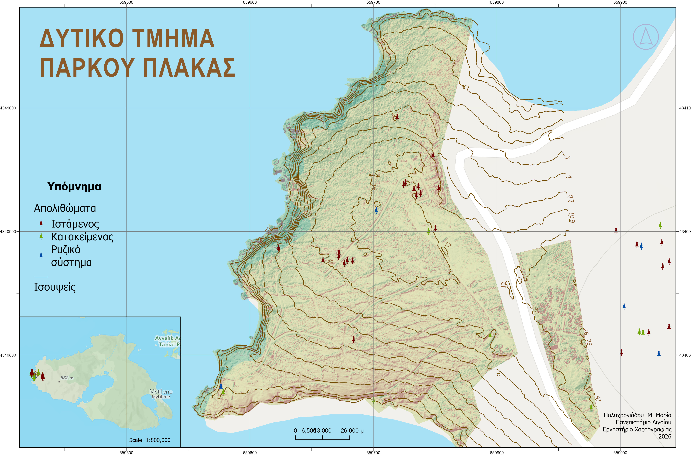

### 2.2 Flight plans

| Flight | Aircraft and sensor | Height | Speed | GSD | Images | Area | Overlap (front/side) |
|---|---|---|---|---|---|---|---|
| Whole park (both parts) | Matrice, Zenmuse L1 LiDAR | 80 m | 4.5 m/s | 2.18 cm/px | 165 | 113,439 m² | 80% / 20% |
| Western part | Mavic 3E Wide | 120 m | 8 m/s | 3.23 cm/px | 98 | 0.10 km² | 80% / 70% |
| Fossil site 1 | Mavic 3E | 25 m (terrain follow) | 3.7 m/s | 0.67 cm/px | 94 | 324 m² | 90% / 85% |
| Fossil site 2 | Mavic 3E | 25 m (terrain follow) | 3.7 m/s | 0.67 cm/px | 65 | 721 m² | 90% / 85% |
| Fossil site 3 | Mavic 3E | 25 m (terrain follow) | 3.7 m/s | 0.67 cm/px | 56 | 682 m² | 90% / 85% |

Site 3 (logs 4 to 8) was chosen as the reference site for the detailed processing.

**Ground sampling distance:** `GSD = (H · Sw) / (f · IMw)`, where H is flight height, Sw is sensor width, f is focal length and IMw is image width in pixels.

#### Whole park: DJI Matrice (Zenmuse L1)

Flown at 80 m in a top-down pattern with 80% front and 20% side overlap, in 12 minutes 7 seconds. The mapped area was 113,439 m² at a GSD of 2.18 cm/px.

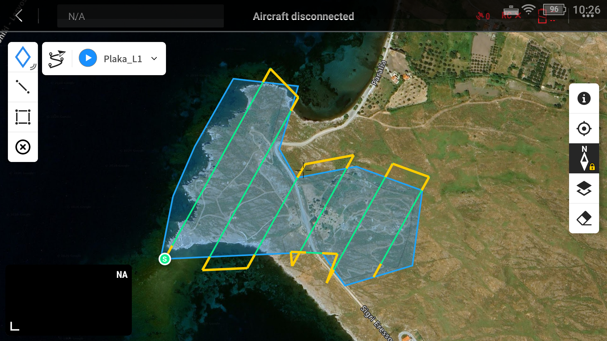
*Flight plan used with the Matrice and Zenmuse L1 LiDAR.*

#### Western section and fossil sites: Mavic 3 Enterprise

The western section was flown at 120 m and 8 m/s (5 min 11 s, 2.44 km, 98 images). The fossil sites were flown much lower, at 25 m with terrain-following altitude, at 3.7 m/s and with 90% front and 85% side overlap.

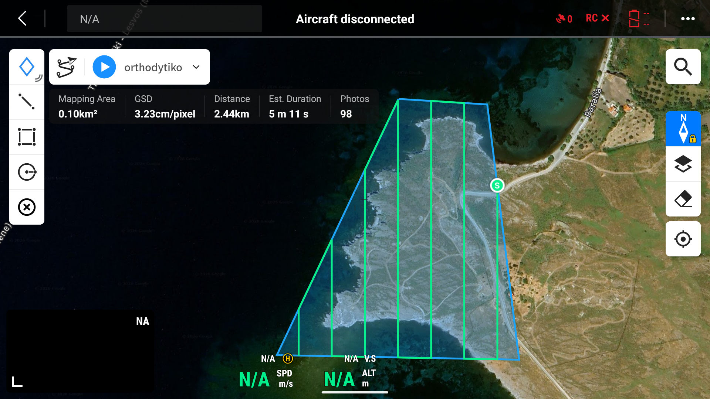
*Flight plan used with the Mavic 3E Wide.*

### 2.3 Data processing

1. **Photogrammetry (Agisoft Metashape):** imported and aligned the photos of the park and the fossil site separately, built a dense point cloud, then a 3D mesh, texture and orthomosaic.
2. **Cloud comparison (CloudCompare):** exported the point clouds as `.las` and ran two independent cloud-to-cloud (C2C) comparisons: (1) the park-scale Mavic 3E cloud against the Zenmuse L1 LiDAR cloud, and (2) the park-scale Mavic 3E cloud against the fossil-site Mavic 3E cloud, cropped to the area where they overlap.
3. Produced standardized A4 cartographic layouts: a regional park overview map and a detailed fossil site map, maintaining full photogrammetric fidelity. Generated a DEM from the LiDAR point cloud and extracted 1 m contour lines in ArcGIS-pro.

## 3. Results

### 3.1 Point clouds

The park-scale cloud has 35,039,257 points and the fossil-site cloud has 34,388,203, both at high quality in Metashape.

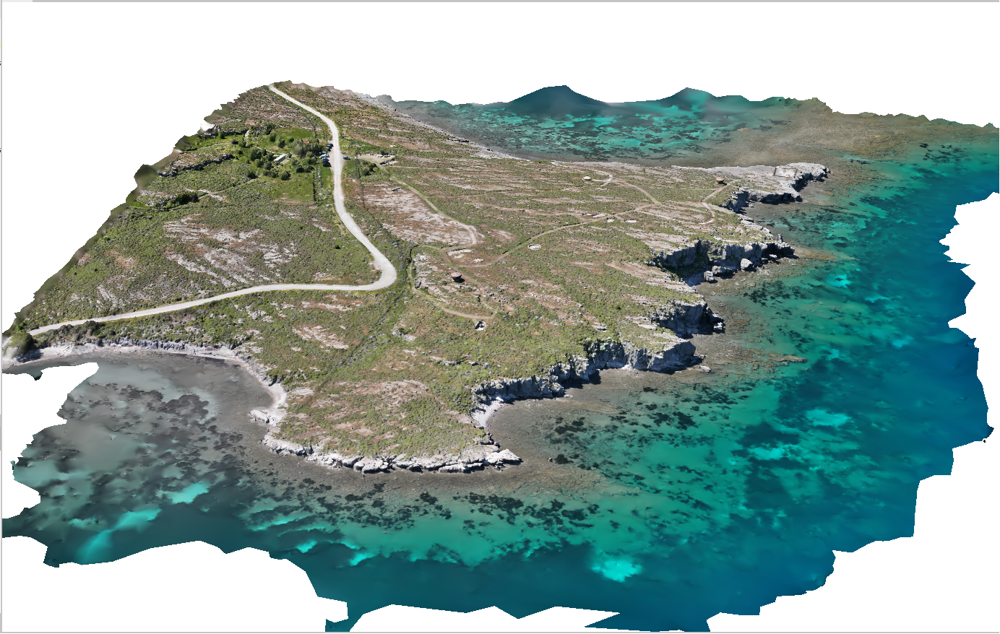
*3D point cloud, western part of the park.*

At 25 m flight height the fossil site is far denser: about 18,850 points/m² compared with about 230 points/m² for the park-scale cloud.

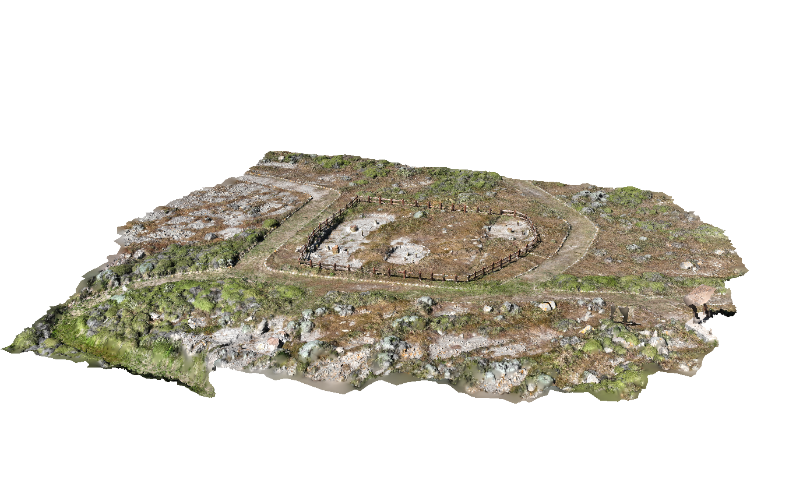
*3D point cloud, fossil site.*

### 3.2 3D model of the fossil site

A high-resolution mesh (5.67 million faces) was built from the point cloud, textured from the original images and cropped around the fenced site. A medium-quality version (573,774 faces) is available on Sketchfab: [mariapolchr on Sketchfab](https://sketchfab.com/mariapolchr).

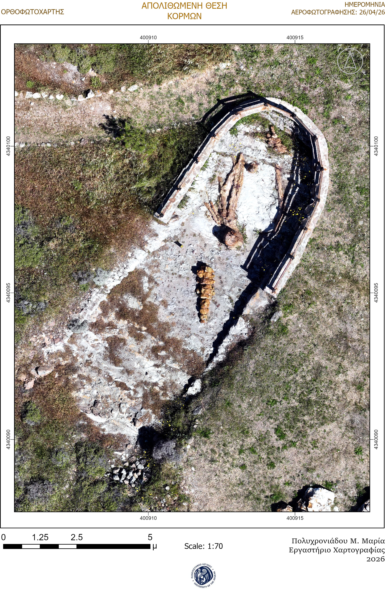
*Textured 3D model of the fossil site, high quality.*

### 3.3 Orthophoto maps

Two A4 maps were produced from the orthomosaics. The 1:10 map shows the fossil trunks in fine detail, and the 1:100 map gives the general picture of the western zone.

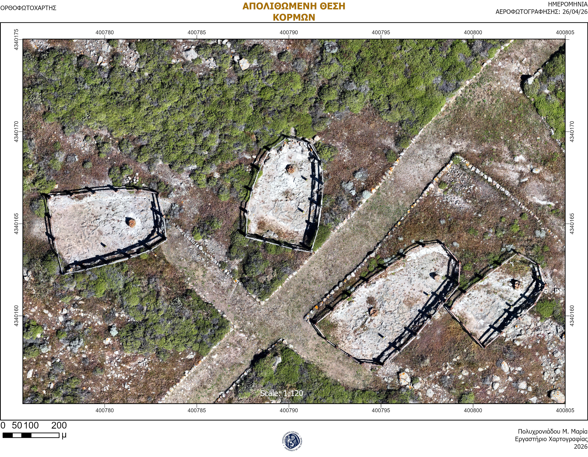
*Orthophoto map of the fossil site.*

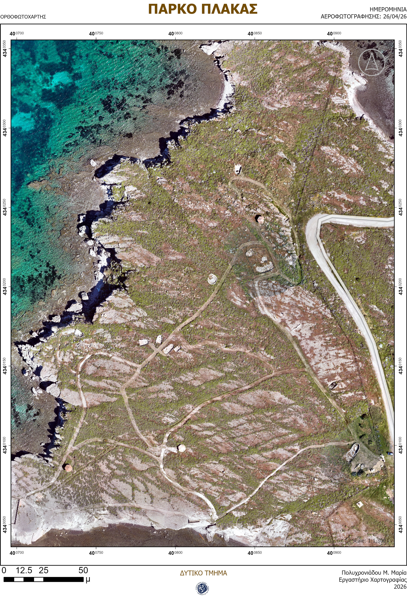
*Orthophoto map of the western part of the park.*

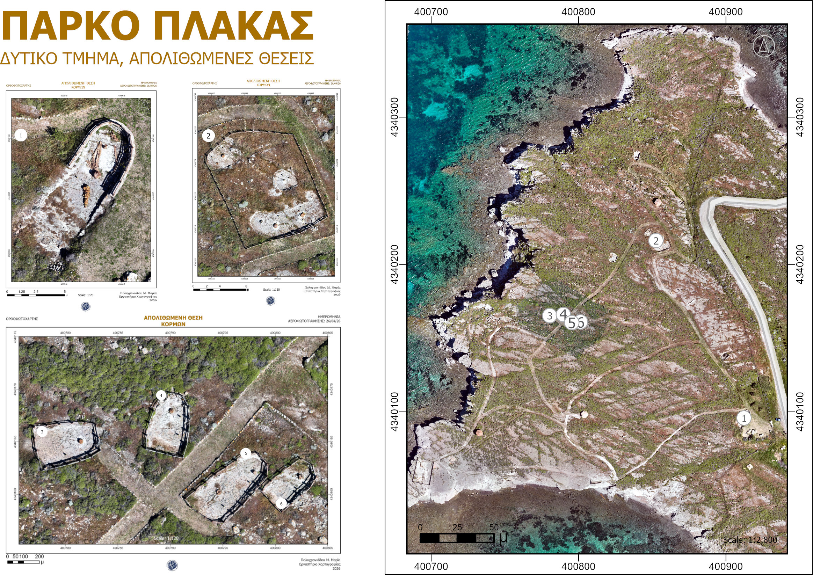
*Fossil positions.*

### 3.4 Digital terrain model (DEM)

The DEM from the L1 LiDAR cloud covers the western section, and 1 m contour lines show the terrain.

*DEM and contour lines, 1 m interval.*

### 3.5 Cloud comparisons

#### 3.5.1 Park scale: Mavic 3E vs Zenmuse L1

The two clouds were cropped to the same location and compared. First, the point density of each cloud (surface density and number of neighbours) as Gauss histograms. The LiDAR cloud has a broad, uneven distribution, while the photogrammetric cloud has a narrow, uniform one.

<table>
  <tr>
    <td>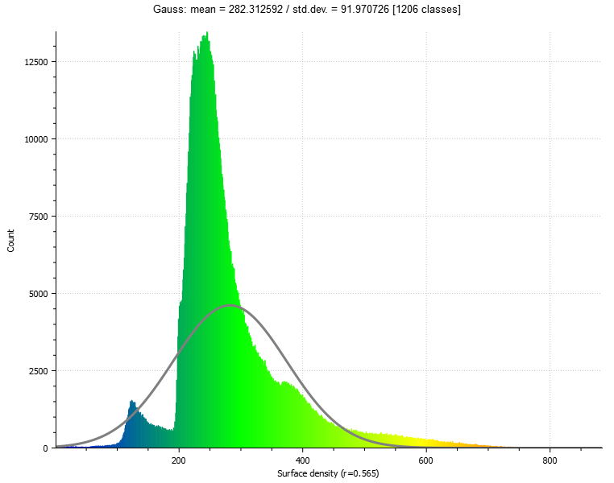</td>
    <td></td>
  </tr>
  <tr>
    <td align="center"><em>Surface density, Matrice L1</em></td>
    <td align="center"><em>Number of neighbours, Matrice L1</em></td>
  </tr>
</table>

<table>
  <tr>
    <td>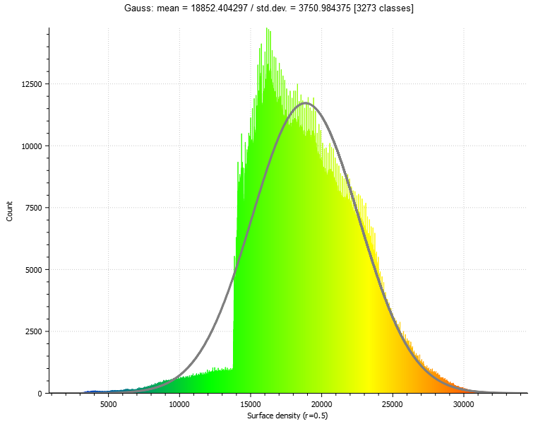</td>

  </tr>
  <tr>
    <td align="center"><em>Surface density, Mavic 3E</em></td>
  
  </tr>
</table>

| | Mavic 3E | Zenmuse L1 |
|---|---|---|
| Mean density | 236.6 points/m² | 282.3 points/m² |
| Std. deviation | 28.3 | 92.0 |

Then the cloud-to-cloud (C2C) distances. Colours show the distance between the two clouds, and red and yellow patches mark the largest differences.

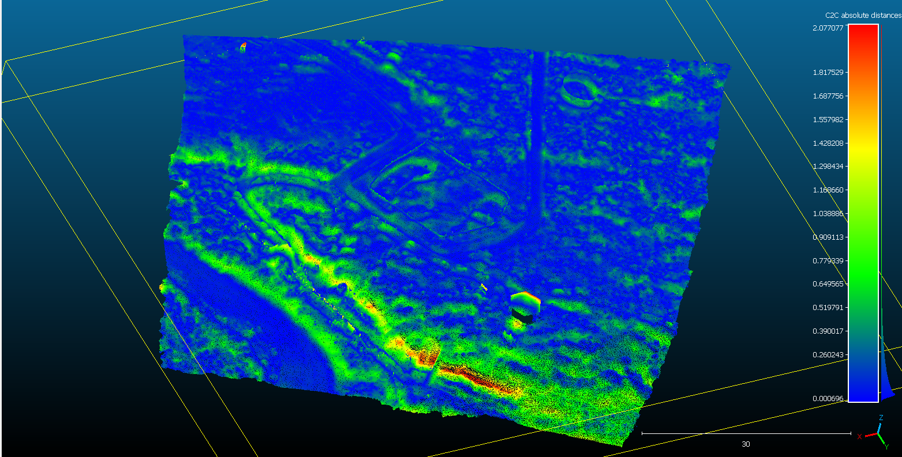
*C2C comparison, Mavic 3E vs Zenmuse L1.*

<table>
  <tr>
    <td>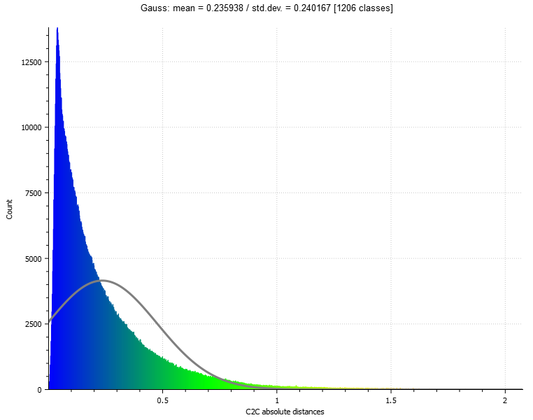</td>
    <td>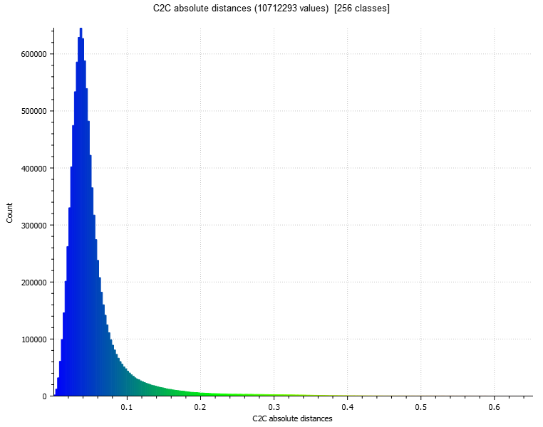</td>
  </tr>
  <tr>
    <td align="center"><em>Gauss histogram, mean</em></td>
    <td align="center"><em>C2C histogram, absolute distances</em></td>
  </tr>
</table>

C2C distance: mean 0.236 m, std 0.240 m, RMS 0.337 m.

#### 3.5.2 Park scale vs fossil-site scale (both Mavic 3E)

The park-scale cloud (1:100) was compared with the fossil-site cloud (1:10), both from the Mavic 3E, cropped to the area where they overlap. The fossil-site cloud is about 80 times denser.

<table>
  <tr>
    <td>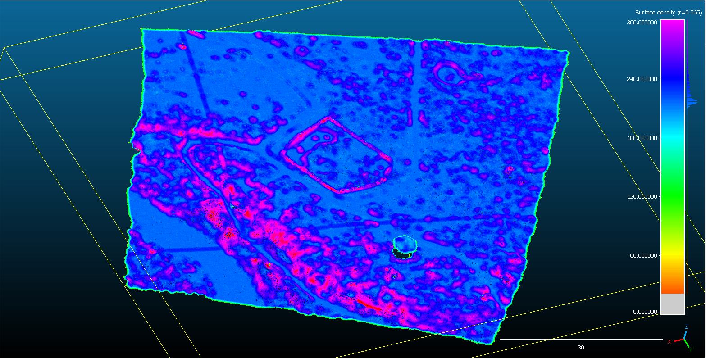</td>
    <td>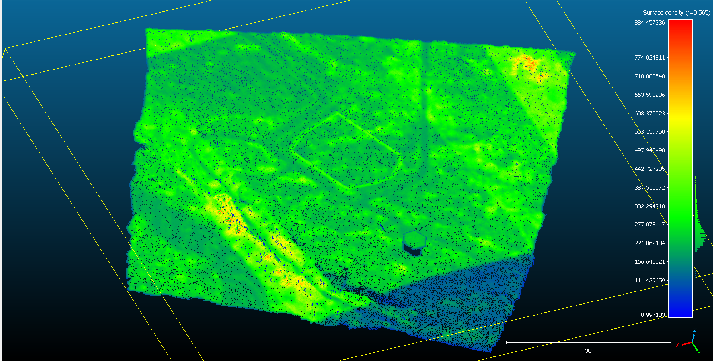</td>
  </tr>
  <tr>
    <td align="center"><em>Surface density, park scale</em></td>
    <td align="center"><em>Surface density, fossil site</em></td>
  </tr>
</table>

| | Park scale | Fossil site |
|---|---|---|
| Mean density | 230.5 points/m² | 18,852 points/m² |
| Std. deviation | 32.6 | 3,751 |

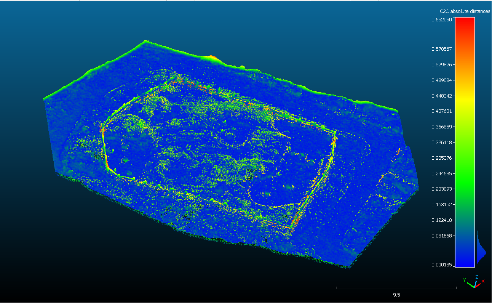
*C2C comparison, park scale vs fossil-site scale.*

<table>
  <tr>
    <td></td>
    <td>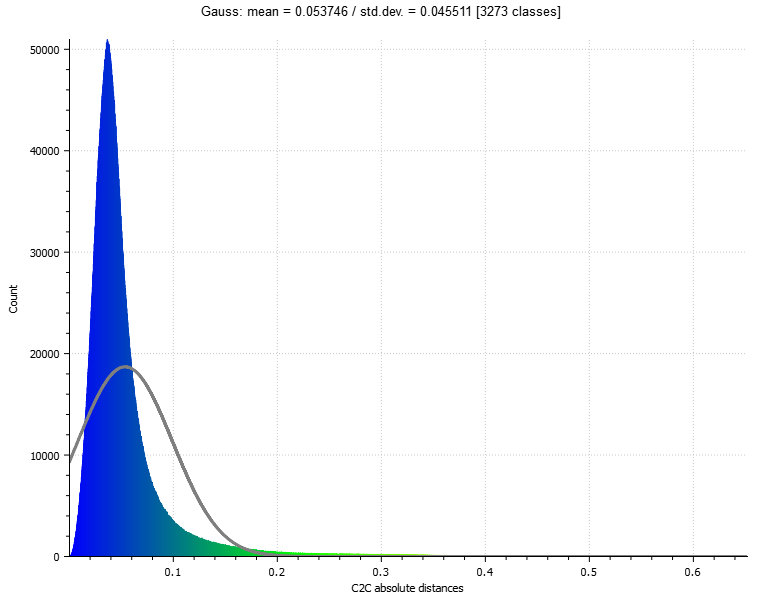</td>
  </tr>
  <tr>
    <td align="center"><em>C2C histogram, absolute distances</em></td>
    <td align="center"><em>Gauss histogram, mean</em></td>
  </tr>
</table>

C2C distance: mean 0.054 m, std 0.046 m, RMS 0.070 m.

## 4. Discussion

### 4.1 Park scale: Mavic 3E vs Zenmuse L1

The photogrammetric cloud has an even point distribution, while the LiDAR cloud is denser on average but much more uneven. Most C2C distances are below 0.5 m, with a strong right skew. The largest differences appear along the fence and the paths, where LiDAR and photogrammetry capture vertical structures differently. In open ground and vegetation, the two clouds agree more closely.

### 4.2 Park scale vs fossil-site scale (Mavic 3E)

The scale of capture changes the structure of the cloud. The much lower flight height (25 m instead of 120 m) and smaller GSD give a far denser cloud on the fossil site. Even so, the two clouds agree geometrically to a high degree (mean 0.054 m, most values below 0.1 m). Differences appear mainly along the fence.

### 4.3 Comparing the comparisons

The Mavic-to-Mavic comparison (mean 0.054 m, RMS 0.070 m) shows much smaller deviations than the Mavic-to-LiDAR one (mean 0.236 m, RMS 0.337 m). Clouds produced by the same sensor and method agree better. Note that the two comparisons differ in more than the sensor (flight height, pattern and processing), so the gap can't be attributed to the sensor alone.

## 5. Conclusions

- Photogrammetry with the Mavic 3E gave high-quality point clouds at both scales, and at 25 m height, a GSD of about 0.67 cm/px. The 3D models and orthomosaics show the fossil site's surface and morphology in fine detail.
- The two Mavic 3E clouds agree closely across scales (mean 0.054 m, RMS 0.070 m), so a multi-scale approach with one sensor gives consistent results.
- The Mavic 3E and Zenmuse L1 clouds show larger differences (mean 0.236 m, RMS 0.337 m), mostly on vertical structures like the fence.
- Combining photogrammetry and LiDAR is useful for documenting a geosite: LiDAR gives an accurate terrain model, while photogrammetry gives detailed visual information and surface detail.

## Limitations

- C2C distance measures how well two clouds agree with each other, not how accurate either one is against the ground.
- The Mavic 3E vs L1 comparison mixes two methods, two flight heights and two flight patterns, so it can't isolate the effect of the sensor.
- Only one fossil site (site 3) was processed in detail, and data were collected on a single day.
- The A4 maps were made at two fixed scales and are not a continuous multi-scale product.

## Tools

DJI Mavic 3 Enterprise, DJI Matrice with Zenmuse L1, Agisoft Metashape, CloudCompare, ArcGIS-pro for the maps and DEM, Sketchfab.

## Repository contents

- `*.jpg`, `*.png`: maps, figures and histograms used in this README
- `Geopark.pdf`, `Plaka_Park.pdf`, `plaka_location.pdf`: map layouts as PDF

## References

Kelepertzis, E., Roussos, A., Drougas, C., Kypritidou, Z., Vassilakis, E., & Zouros, N. (2026). Soil geochemical patterns in Lesvos island UNESCO Global Geopark, Greece: Unveiling the influence of diverse geology. *Applied Geochemistry*, 205. https://doi.org/10.1016/j.apgeochem.2026.106893

Kotis, K., Angelis, S., Moraitou, E., Kopsachilis, V., Papadopoulou, E. E., Soulakellis, N., & Vaitis, M. (2023). A KG-Based Integrated UAV Approach for Engineering Semantic Trajectories in the Cultural Heritage Documentation Domain. *Remote Sensing*, 15(3). https://doi.org/10.3390/rs15030821

Papadopoulou, E. E., Papakonstantinou, A., Kapogianni, N. A., Zouros, N., & Soulakellis, N. (2022a). VR Multiscale Geovisualization Based on UAS Multitemporal Data: The Case of Geological Monuments. *Remote Sensing*, 14(17). https://doi.org/10.3390/rs14174259

Papadopoulou, E. E., Papakonstantinou, A., Vasilakos, C., Zouros, N., Tataris, G., Proestakis, S., & Soulakellis, N. (2022b). Scale issues for geoheritage 3D mapping: The case of Lesvos Geopark, Greece. *International Journal of Geoheritage and Parks*, 10(3), 435-446. https://doi.org/10.1016/j.ijgeop.2022.08.006

Pe-Piper, G., Piper, D. J. W., Anastasakis, G., Zouros, N., & Lyras, G. (2024). Variability in mineralization of the petrified forests in the UNESCO Global Geopark of Lesvos, Greece. *Marine and Petroleum Geology*, 167. https://doi.org/10.1016/j.marpetgeo.2024.106990

Zouros, N. C. (2021). The Miocene Petrified Forest of Lesvos, Greece: Research and Geoconservation Activities. *Geoconservation Research*, 4(2), 635-649. https://doi.org/10.30486/gcr.2021.1927340.1090

*Project developed at the University of the Aegean, Department of Geography.*
